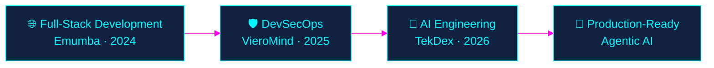
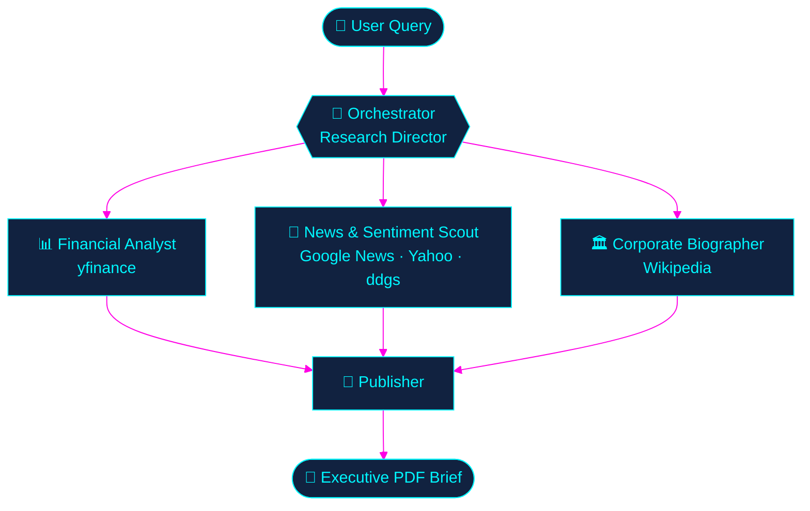
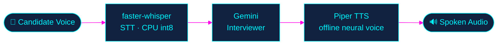

<div align="center">


<a href="https://linkedin.com/in/burraq-e-mohammad">

</a>

<p>
<a href="https://linkedin.com/in/burraq-e-mohammad"></a>
<a href="https://burraqemohammad.vercel.app"></a>
<a href="mailto:burraqemohammad@gmail.com"></a>

</p>

</div>

<!-- Hey recruiter 👋 you found the easter egg. Run `sudo hire` at the bottom of this page. -->

---

## 🤖 `> boot_sequence.exe`

```text
         ╭───────╮        > booting burraq.ai ................ [ OK ]
    ╭────┤ ●   ● ├────╮   > loading agents ................... [ OK ]
    │    │  ───  │    │   > mounting RAG memory .............. [ OK ]
    ╰────┤ ╰───╯ ├────╯   > calibrating LoRA adapters ........ [ OK ]
         ╰───┬───╯        > linking AWS Bedrock .............. [ OK ]
        ╭────┴────╮       > securing pipeline (shift-left) ... [ OK ]
        │ [ A I ] │
        ╰─┬─────┬─╯       > status: READY TO BUILD █
          ╵     ╵
```

## 🧬 `whoami`

```python
class BurraqEMohammad:
    """AI Engineer · Gold Medalist · Builder of agentic systems"""

    role        = "AI Engineer"
    base        = "Islamabad, Pakistan"
    education   = "B.S. Software Engineering · 3.73 GPA · Gold Medalist"
    status      = "Open to AI Engineering opportunities"

    superpowers = [
        "Agentic AI & multi-agent orchestration",
        "Retrieval-Augmented Generation (RAG)",
        "LLM fine-tuning (LoRA / QLoRA)",
        "Real-time voice AI",
        "DevSecOps · CI/CD · Infrastructure as Code",
    ]
    daily_drivers = ["Python", "LangGraph", "LangChain", "PyTorch", "FastAPI", "AWS Bedrock"]
    mindset       = "shift-left security, production-grade from day one"

    def mission(self) -> str:
        return "Bridge the gap between intelligent models and dependable, production-ready scale."


if __name__ == "__main__":
    print(BurraqEMohammad().mission())
```

## 🧭 Evolution Path



## 📡 System Diagnostics

```text
┌───────────── SYSTEM DIAGNOSTICS ─────────────┐
│ ACADEMIC_GPA ........ 3.73 · Gold Medalist   │
│ RELEASE_SPEED ....... +50% faster via CI/CD  │
│ VULNS_REMEDIATED .... 15+ critical           │
│ ONBOARDING_TIME ..... -30% via documentation │
│ LLM_ERROR_MSE ....... -85% after QLoRA       │
│ HACKATHON ........... 1st · VieroMind 2025   │
└──────────────────────────────────────────────┘
```

## 🛠️ Tech Arsenal

<div align="center">

<b>🧠 AI & LLMs</b><br/>


<br/><br/>

<b>🎙️ Vector DBs & Speech</b><br/>


<br/><br/>

<b>⚙️ Languages & Frameworks</b><br/>


<br/><br/>

<b>🗄️ Databases</b><br/>


<br/><br/>

<b>☁️ Cloud & DevSecOps</b><br/>


<br/><br/>

</div>

## 🚀 Featured Missions

<details open>
<summary><b>👑 Multi-Agent Corporate Research System</b> &nbsp;·&nbsp; <i>supervisor-worker agent pipeline</i></summary>

<br/>

Single-prompt LLMs hallucinate tickers for private startups and blur similarly named companies. This system splits deep financial research across guardrail-backed specialist agents.



- 🛡️ **Guardrails:** classifies public vs. private companies, so no hallucinated tickers or empty N/A tables
- 🔁 **Resilient LLM layer:** Gemini and Groq with provider fallback, plus an offline heuristic fallback
- 🧱 **Full stack:** FastAPI REST service with Pydantic validation, Streamlit executive dashboard, one-click PDF reports (fpdf2)

    

<!-- 🔗 add repo link here -->

</details>

<details open>
<summary><b>🎙️ Real-Time AI Voice Mock Interviewer</b> &nbsp;·&nbsp; <i>hands-free, low-latency speech pipeline</i></summary>

<br/>



- 🧠 Questions tailored to the candidate's resume, the job description, and company hiring bars, ending with a scored evaluation
- ⚡ Quantized speech models on CPU; async FastAPI offloads CPU-bound inference to keep the event loop responsive
- 🔒 Rate limiting, MIME validation, and payload caps; **50-test offline pytest suite** using service fakes
- 🌐 Web client with live waveform, automatic turn-taking, and one-tap barge-in

   

<!-- 🔗 add repo link here -->

</details>

<details open>
<summary><b>⚙️ Llama 3.2 (3B) LoRA / QLoRA Fine-Tuning</b> &nbsp;·&nbsp; <i>product price prediction on a single T4</i></summary>

<br/>

4-bit NF4 quantization (~2.2 GB footprint), LoRA adapters (r=32, α=64) over attention projections, 625 training steps, tracked in Weights & Biases. The 73.4 MB adapter is published on Hugging Face Hub.

| Metric | Base Llama-3.2-3B (zero-shot) | Fine-tuned (LoRA / QLoRA) |
|:--|:--:|:--:|
| Average error | $126.36 | **$64.31** |
| MSE | 85,565 | **12,640** &nbsp;📉 *~85% lower* |
| R² | -289.3% | **42.5%** |

[](https://lnkd.in/eHMRXj2c)

</details>

<details open>
<summary><b>🛠️ Autonomous IT Support Agent</b> &nbsp;·&nbsp; <i>LangGraph → AWS Bedrock</i></summary>

<br/>

- 🔍 **Local build:** LangGraph state machine with FAISS RAG over a 28-page VPN guide plus SQLite action tools (ticketing, access checks, provisioning), observed through a live Streamlit tool-trace console
- ☁️ **Cloud-native migration:** Bedrock Agents and Knowledge Base, OpenAPI 3.0 action groups, and a serverless Lambda router over DynamoDB
- 💂 **Guardrails:** docs first, credentials before ticketing, user confirmation before closing

<!-- 🔗 add repo link here -->

</details>

<details open>
<summary><b>🧠 Enterprise RAG & Semantic Search</b> &nbsp;·&nbsp; <i>grounded answers, verifiable sources</i></summary>

<br/>

- 📑 **LCEL + ChromaDB:** hierarchical chunking, MMR retrieval (fetch_k=10, k=3, λ=0.7), citation-enforced answers, and a CRUD-capable index
- 🌲 **Pinecone Serverless:** 780+ vectors (384-D), weighted feature engineering (title 5x, section 3x, description 2x, tech 1x), and dual-namespace retrieval

<!-- 🔗 add repo link here -->

</details>

<details>
<summary><b>🧩 Side Quests</b> &nbsp;·&nbsp; <i>more things I have built</i></summary>

<br/>

**AI & NLP**

- 🏢 Employee HR Policy RAG Chatbot (LangChain, ChromaDB, Gemini, Gradio)
- 🔄 Stateful LangGraph Agent with Memory Eviction (SQLite checkpointing, Gradio)
- 🔥 XLNet Emotion Detection
- 🎯 BERT Extractive Question Answering
- 📰 Fake News Classification (VADER, LDA/LSA, scikit-learn)

**Full-Stack**

- 🏛️ The Book of Humanity: interactive 3D permanent digital legacy archive (Next.js, Three.js, PostgreSQL)
- 💼 BurraqBolt Solutions: consultancy platform with a Groq-powered AI receptionist
- 🏠 AI-Powered Real Estate Investment Advisor: ML price prediction with 92% accuracy
- ☁️ Serverless Job Application Portal (AWS Lambda, DynamoDB, S3, Next.js)

</details>

## 📜 Mission Log

| Period | Role | Where | What went down |
|:--|:--|:--|:--|
| **Sep 2026 – Oct 2026** | AI Engineer Intern | **TekDex** | Mentor-guided training through courses and hands-on AI projects, with weekly assessments |
| **Dec 2025 – Jan 2026** | DevSecOps Engineer Intern | **VieroMind** | Releases **50% faster** with CI/CD; remediated **15+ critical vulnerabilities**; onboarding time down **30%** |
| **Jul 2024 – Aug 2024** | Full Stack Developer Intern | **Emumba** | Shipped full-stack features under mentor supervision in an agile, cross-functional team |

## 🏆 Achievements & Certifications

- 🥇 **Gold Medalist** · B.S. Software Engineering, Iqra University · **3.73 GPA** (perfect 4.0 in 4th, 5th, and 8th semesters)
- 🏆 **1st Position** · VieroMind 2025 (24-hour hackathon)
- 🥈 **2nd Position** · BrainByte Tech Competition (among 30 teams)
- ☁️ AWS Cloud Practitioner Essentials · AWS
- 🤖 Introduction to Generative AI: Art of the Possible · AWS
- 🐍 Developing AI Applications with Python and Flask · IBM
- 📊 Python for Data Science, AI & Development · IBM

## 📈 Activity

<div align="center">

<picture>
  <source media="(prefers-color-scheme: dark)" srcset="https://raw.githubusercontent.com/burraq-e-mohammad/burraq-e-mohammad/output/github-snake-dark.svg" />
  <source media="(prefers-color-scheme: light)" srcset="https://raw.githubusercontent.com/burraq-e-mohammad/burraq-e-mohammad/output/github-snake.svg" />
  
</picture>


</div>

## 📬 Initiate Contact

```bash
$ sudo hire --engineer "Burraq E Mohammad" --role "AI Engineer"
[sudo] password for recruiter: ********
✔ Access granted
✔ Opening inbox → burraqemohammad@gmail.com
✔ Portfolio     → burraqemohammad.vercel.app
```

<div align="center">

<a href="https://linkedin.com/in/burraq-e-mohammad"></a>
<a href="mailto:burraqemohammad@gmail.com"></a>
<a href="https://burraqemohammad.vercel.app"></a>

<br/><br/>

<i>"Intelligent models are easy to demo. Dependable ones are engineered."</i>


</div>
